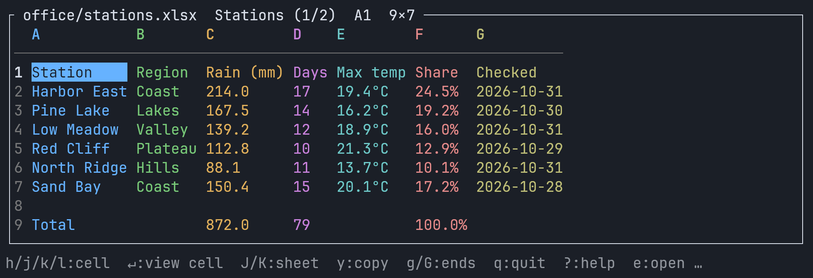
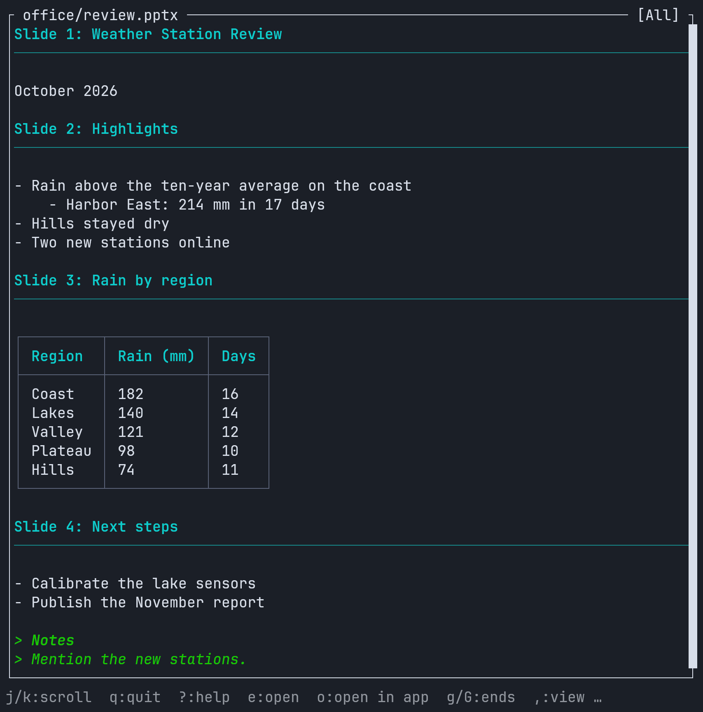

# konoma-office

The Office plugins of [konoma](https://github.com/LESIM-Co-Ltd/konoma), a terminal file browser:
spreadsheets, Word documents and presentations, read in Rust without an Office installation. They
are built into konoma, and this repository also builds a standalone program for one file.





| Crate | Contents |
|---|---|
| [`konoma-office`](crates/konoma-office/README.md) | The `spreadsheet`, `document` and `presentation` plugins and the `konoma-office` program |
| [`konoma-office-core`](crates/konoma-office-core/README.md) | The readers and the slide drawing, usable on their own |

Usage, keys and configuration are in the
[`konoma-office` README](crates/konoma-office/README.md); the reading limits are in the
[`konoma-office-core` README](crates/konoma-office-core/README.md).

## Try it

From a clone of this repository:

```sh
cargo run -- samples/sample.xlsx
cargo run -- samples/sample.docx
cargo run -- samples/sample.pptx
```

Press `q` to quit, `?` for the keys. `samples/` also has `.xls`, `.ods`, `.odp` and a Japanese
`.pptx`.

## Build and test

Rust 1.92 or newer.

```sh
cargo build
cargo test
cargo test --no-default-features
```

## License

MIT, as for [konoma](https://github.com/LESIM-Co-Ltd/konoma). One data file in
`konoma-office-core` is under Ecma International's license instead; see
[its notice](crates/konoma-office-core/src/slide_draw/presets/NOTICE.md).
