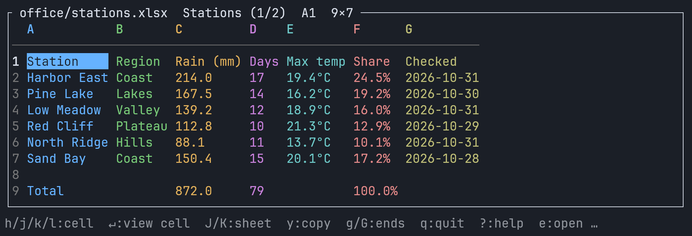
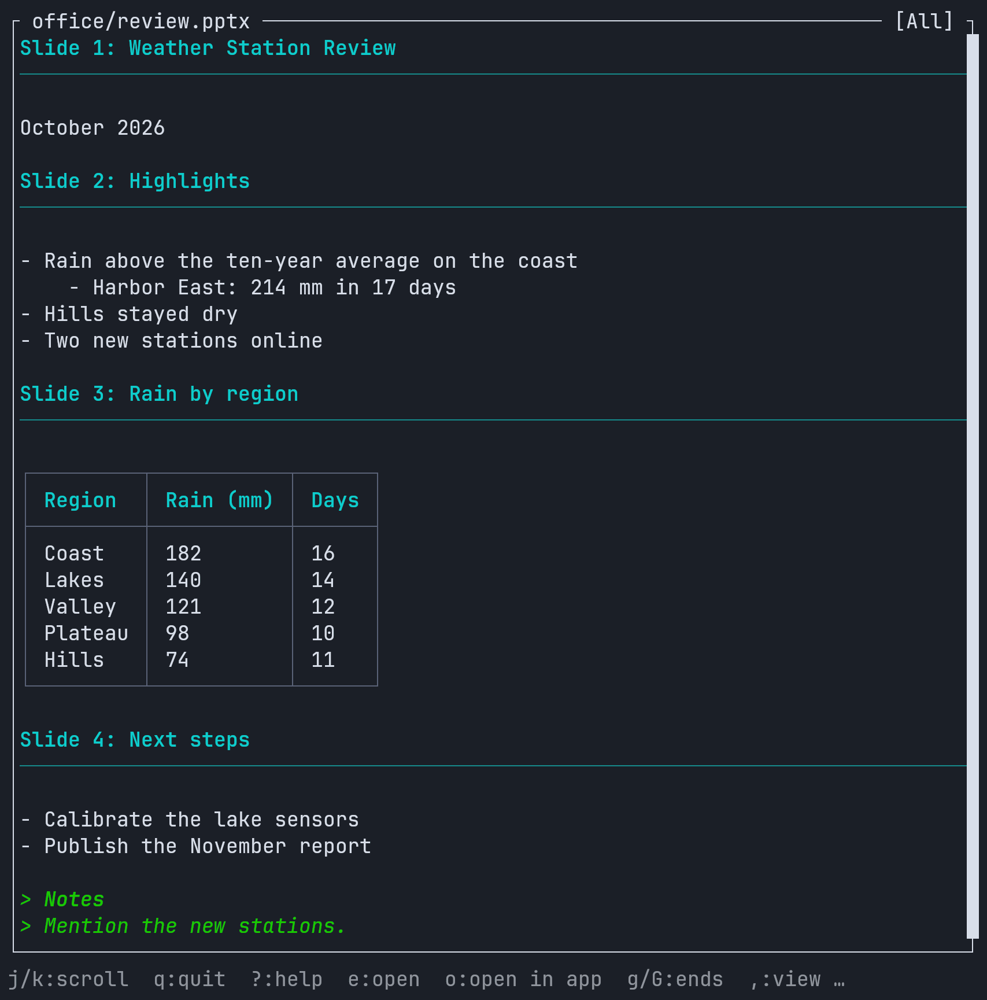

# konoma-office-core

Pure-Rust readers for spreadsheets, Word documents and presentations, plus slide drawing to SVG.
It is the core of [konoma](https://github.com/LESIM-Co-Ltd/konoma)'s Office preview and of
[konoma-office](https://crates.io/crates/konoma-office).





| Input | Entry point | Result |
|---|---|---|
| `.xlsx` `.xlsm` `.xltx` `.xltm` `.xlsb` `.xls` `.ods` | `load_workbook_sheet_cancellable` | `Workbook`: visible sheets; cells, display text and formulas of the one asked for |
| `.docx` and `.odt` families | `docx::load_document` | `docx::Document`: Markdown and pictures |
| `.pptx` and `.odp` families | `docx::pptx::load_presentation` | The same, plus slide information and one drawable scene per slide |

`docx::load_document_cancellable` and `docx::pptx::load_presentation_cancellable` take a cancel
handle. `numfmt::format_value` applies an Office number format, and `slide_draw::render_svg_cancellable`
turns a slide scene into SVG.

It leaves out: writing files, running macros or formulas, rasterising the SVG, any user interface,
and user-facing error text (`OfficeError` is a reason: `Encrypted`, `TooLarge`, `Corrupt`,
`Unsupported`, `Io`).

```toml
[dependencies]
konoma-office-core = "0.1"
```

```rust,no_run
use std::path::Path;
use std::sync::Arc;

use konoma_office_core::docx::{self, DocOptions};
use konoma_office_core::{load_workbook_sheet_cancellable, slide_draw, LoadOptions};

fn main() -> Result<(), konoma_office_core::OfficeError> {
    // Only the sheet asked for (here the first) has its cells loaded.
    let opts = LoadOptions::default();
    let book = load_workbook_sheet_cancellable(Path::new("book.xlsx"), &opts, 0, None)?;
    for sheet in book.sheets.iter().filter(|s| s.loaded) {
        println!("{}: {}x{}", sheet.name, sheet.nrows, sheet.ncols);
        println!("A1 = {}", sheet.display(0, 0));
    }

    // Word (.docx, .odt, ...) to Markdown.
    let doc = docx::load_document(Path::new("report.docx"), &DocOptions::default())?;
    println!("{}", doc.markdown);

    // A presentation: Markdown text, and one drawable scene per slide.
    let deck = docx::pptx::load_presentation(Path::new("talk.pptx"), &DocOptions::default())?;
    let media = |key: &str| {
        let image = deck.images.iter().find(|i| i.key == key)?;
        Some(Arc::new(image.bytes.clone()))
    };
    if let Some(scene) = deck.slide_scenes.first() {
        let slide = slide_draw::render_svg_cancellable(scene, &media, &|| false);
        println!("{} bytes of SVG", slide.svg.len());
    }
    Ok(())
}
```

## Limits

Input is treated as untrusted. A package over a size limit is an error
(`OfficeError::TooLarge`). A conversion that reaches an output budget returns what it has and sets
a truncation flag (`Sheet::rows_truncated`, `Sheet::cols_truncated`, `Document::truncated`).

Package and sheet limits (`container::Limits::default()`):

| Limit | Value |
|---|---|
| File size | 256 MiB |
| zip entries | 10,000 |
| One part, inflated / all parts | 256 MiB / 1 GiB |
| Rows / columns per sheet | 100,000 / 16,384 |
| Cells per sheet | 4,000,000 |
| Cell text per sheet | 128 MiB |

Document and presentation budgets (`docx::DocOptions::default()`), the main ones:

| Budget | Value |
|---|---|
| Markdown | 1,000,000 bytes, 5,000 lines |
| Pictures | 300; 16 MiB each, 96 MiB in total |
| Cells in one table | 20,000 |
| Slides / shapes per slide | 1,000 / 5,000 |
| One presentation XML part / all of them | 16 MiB / 64 MiB |

Both structs are public and have further fields. XML DTD entities are not expanded.

Word support has been checked with files made by LibreOffice, not with files made by Microsoft
Word; slide drawing has been compared with LibreOffice's rendering only. Fonts are substituted, so
line breaks in slides can differ from Office.

## Platform, features, license

- MSRV: Rust 1.92. CI covers macOS and Linux.
- The only feature, `test-hooks`, exists for tests.
- License: MIT, except `src/slide_draw/presets/presetShapeDefinitions.xml`, the preset shape
  definitions of ECMA-376, which are © Ecma International under Ecma's copyright license. See the
  [notice](https://github.com/LESIM-Co-Ltd/konoma-office/blob/main/crates/konoma-office-core/src/slide_draw/presets/NOTICE.md).

Repository: <https://github.com/LESIM-Co-Ltd/konoma-office>
