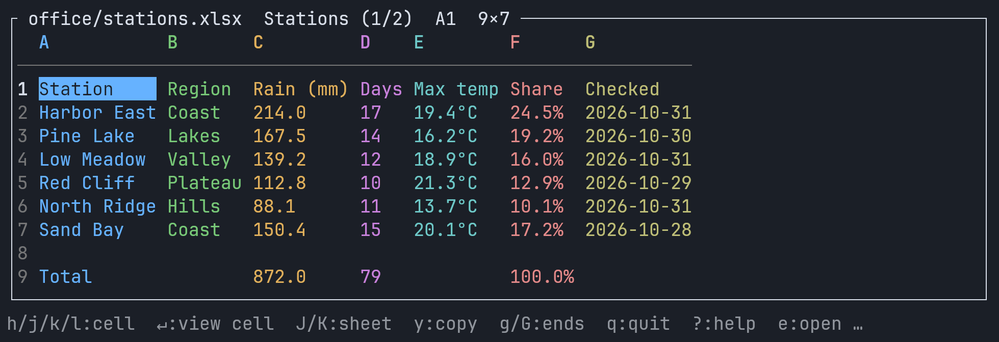
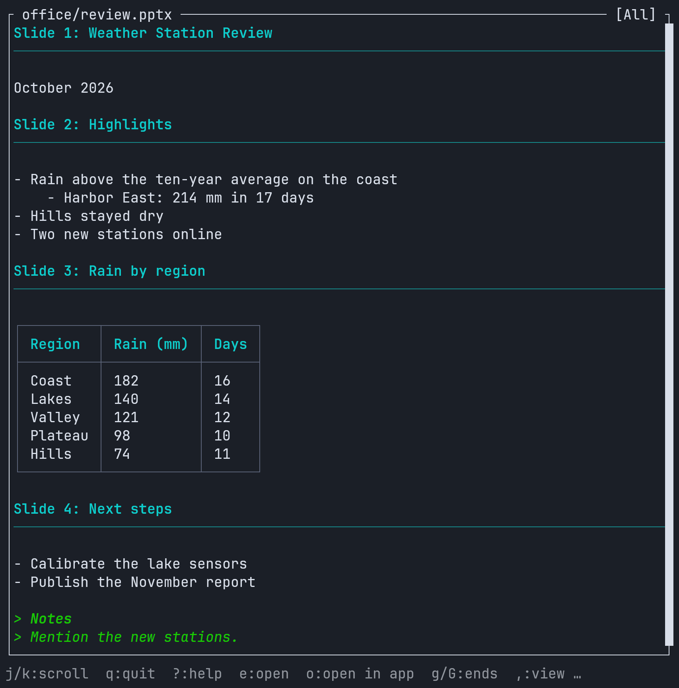

# konoma-office

Spreadsheets, Word documents and presentations shown in the terminal, without an Office
installation. It is part of [konoma](https://github.com/LESIM-Co-Ltd/konoma), a terminal file
browser, and also builds as a program that shows one file.





| Plugin id | Files | What you see |
|---|---|---|
| `spreadsheet` | `.xlsx` `.xlsm` `.xltx` `.xltm` `.xlsb` `.xls` `.ods` | A grid with cells formatted as the file says, one visible sheet at a time |
| `document` | `.docx` `.docm` `.dotx` `.dotm` `.odt` `.ott` | The document converted to Markdown |
| `presentation` | `.pptx` `.pptm` `.ppsx` `.ppsm` `.potx` `.potm` `.odp` `.otp` | The slides as text; konoma can also draw them (see below) |

```text
┌ konoma-office/samples/sample.xlsx  Sales (1/2) +1 hidden  A1  5×6 ───
│  A                           B            C      D       E          F
│───
│1 Quarterly report 四半期報告
│2 Item 品名                   Qty          Price  Rate    Date       Time
│3 Apple りんご                1,234,567.89 ¥1,500 25.6%   2026-10-02 13:05:09
│4 Banana バナナ               42.00        ¥980   5.0%    2024-02-29 00:00:30
│5 Total 合計                  1,234,609.89 ¥2,480 #DIV/0! 1
```

## With konoma

The three plugins are part of konoma's standard build, so there is nothing to add. Because of
that, `konoma plugin install konoma-office` answers that there is nothing to install. In konoma's
`config.toml`, `[plugins.<id>] enabled = false` turns one off.

In konoma, a presentation is drawn slide by slide (`J`/`K` to move, `O` for the slide list, `R`
to switch to text). **The 0.1.0 standalone program shows presentations as text only**: it does not
draw slides and has no slide keys.

## Standalone program

```sh
cargo install konoma-office
konoma-office report.docx
```

It needs an interactive terminal on standard input and output. Spreadsheets and text need no
graphics protocol; pictures inside documents and slides need a terminal that has one (kitty
graphics, iTerm2 or sixel) to be shown properly. CI covers macOS and Linux.

### Command line

| Command | Effect |
|---|---|
| `konoma-office <file>` | Show one file |
| `konoma-office --help`, `-h` | Print the usage |
| `konoma-office --version` | Print the id and version of the three plugins |
| `konoma-office --plugin <id> --version` | The same for one plugin |
| `konoma-office --plugin <id> --manifest` | Print what the plugin declares, as JSON |
| `konoma-office --plugin <id> --serve` | Speak konoma's plugin protocol on standard input and output (for a host, not for typing) |

`--manifest` and `--serve` require `--plugin` because the program carries several plugins. Exit
status 2 is a usage error or a file it does not take; status 1 is a failure to run, such as no
terminal. A file that cannot be read (encrypted, damaged, too large) is reported on screen.

### Keys

| Key | Action |
|---|---|
| `q`, `Esc` | Quit (closes a popup first) |
| `?` | Help |
| `g` / `G` | Top / bottom |
| `Ctrl-d` / `Ctrl-u` | Half a page |
| `Ctrl-f` / `Ctrl-b`, `PageDown` / `PageUp` | A page |
| `e` | Open in an Office app |
| `o` | Open in another app (OS default / Office) |
| `Space` | Menu of actions |
| `,` then `p` | Change how the path is written |

Spreadsheets:

| Key | Action |
|---|---|
| `h` `j` `k` `l` | Move between cells |
| `0` / `$` | First / last column |
| `J` / `K` | Next / previous sheet |
| `Enter` | Cell details: displayed and raw value, type, formula, number format |
| `y` then `c` / `r` / `C` / `f` | Copy the cell / row / column / full file path |

Documents and presentations:

| Key | Action |
|---|---|
| `j` / `k`, arrows | Scroll |
| `,` then `w` | Toggle line wrapping |
| `y` then `n` / `r` / `f` / `p` / `@` | Copy the file name / relative path / full path / parent folder / `@` reference |

There is no search.

`e` and `o` try the matching Microsoft app and then LibreOffice on macOS, falling back to the OS
default; elsewhere they try `libreoffice`, `soffice`, then `xdg-open`.

### Configuration

The program reads konoma's `config.toml` (`$XDG_CONFIG_HOME/konoma/config.toml`, otherwise
`~/.config/konoma/config.toml`). The file is optional. Settings that matter here:

| Setting | Effect |
|---|---|
| `ui.lang` | `"en"`, or `"jp"` / `"ja"` for Japanese. Unset, empty, `"auto"` or `"system"`: the first non-empty one of `LC_ALL`, `LC_MESSAGES`, `LANG` decides (starting with `ja` means Japanese; anything else, or none, English) |
| `ui.keys` | Paging key style, `"vim"` (default) or `"less"` |
| `ui.wrap` | Line wrapping for documents |
| `[keys]`, `[keys.<name>]` | Your key assignments, as in konoma |
| `external.office_apps` | `false` stops it from starting Office apps |

`[plugins.spreadsheet] rainbow = false` turns the column colors off in konoma (it follows
`[plugins.csv] rainbow` when unset). The 0.1.0 standalone program does not apply it, and it also
ignores `[plugins.<id>] enabled`.

## Limits

- Read only: nothing is edited, and macros and formulas are never run. Formula results are the
  ones saved in the file.
- Hidden sheets are not shown; the title says how many there are.
- Old binary `.doc` and `.ppt` files are not read. Password-protected files are not opened.
- Documents: tracked changes are shown in their final form; comments, headers, footers and hidden
  text are not shown. It is a Markdown reading view, not the page layout.
- Long documents and large sheets are cut off at fixed limits; see
  [`konoma-office-core`](https://github.com/LESIM-Co-Ltd/konoma-office/blob/main/crates/konoma-office-core/README.md#limits).

## As a library

Use `default-features = false` to leave out the standalone program (the `app` feature, on by
default).

```toml
[dependencies]
konoma-office = { version = "0.1", default-features = false }
konoma-plugin = "0.1"
```

```rust
use konoma_plugin::Plugin;

fn main() {
    for plugin in konoma_office::plugins() {
        let manifest = plugin.manifest();
        println!("{} {}", manifest.id, manifest.version);
    }
}
```

`SpreadsheetPlugin`, `DocumentPlugin` and `PresentationPlugin` are the
[konoma-plugin](https://crates.io/crates/konoma-plugin) implementations.

MSRV: Rust 1.92. License: MIT.
Repository: <https://github.com/LESIM-Co-Ltd/konoma-office>
